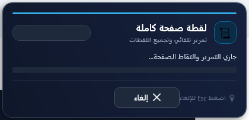
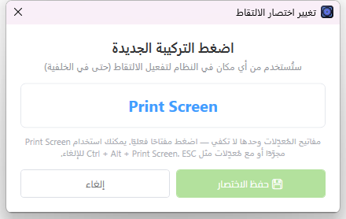
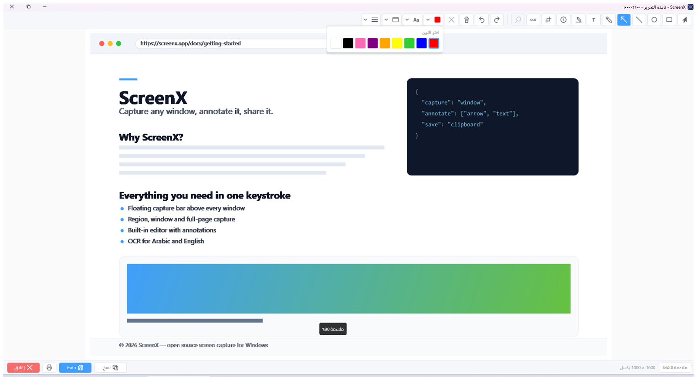
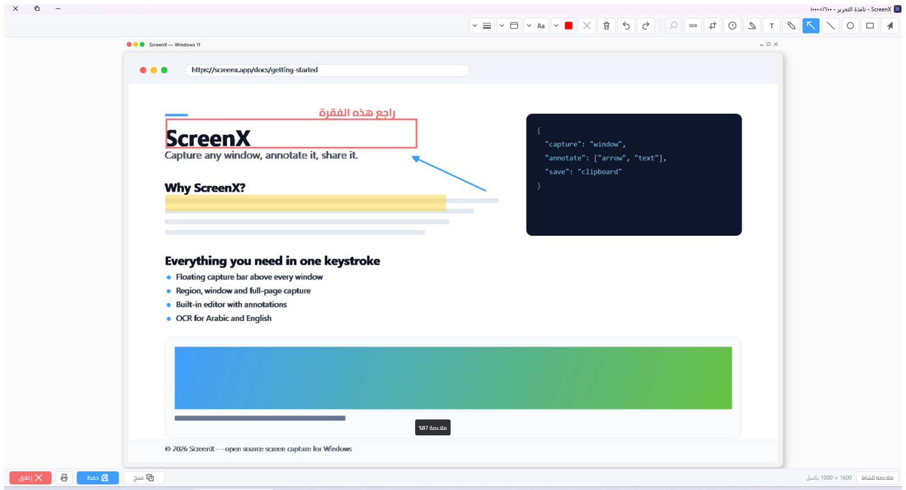
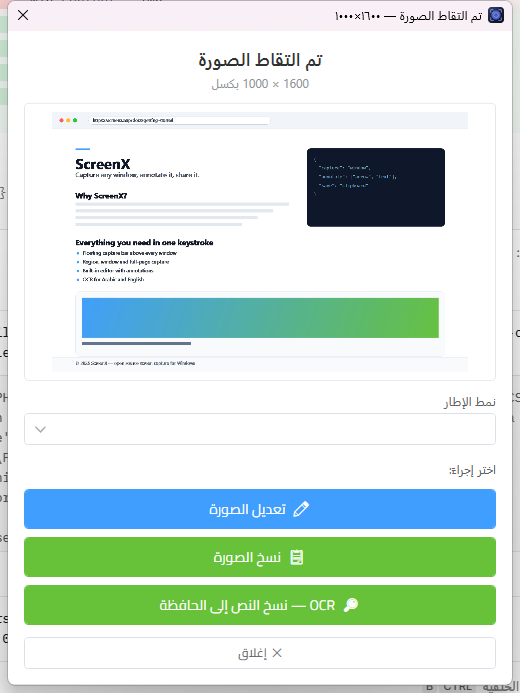
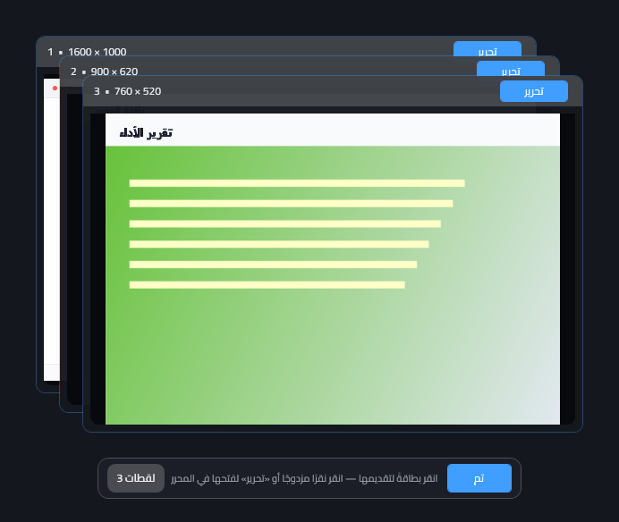
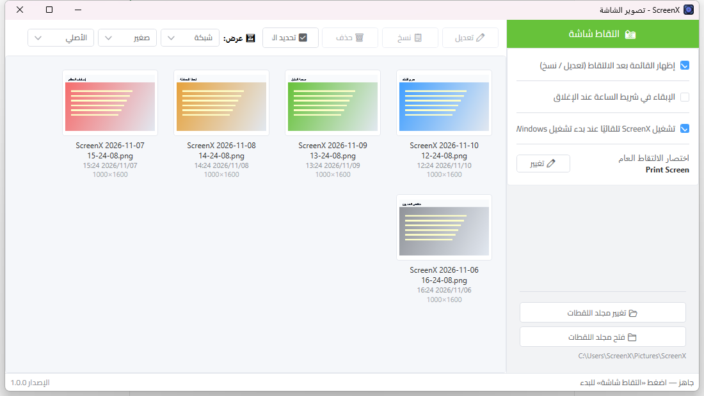

<div dir="rtl" align="right">

# ScreenX — دليل الميزات

تطبيق سطح مكتب لويندوز مبني بـ **WPF / .NET 8**، بواجهة عربية كاملة من اليمين إلى اليسار.
يجمع بين **التقاط الشاشة** (نافذة، منطقة، صفحة كاملة) و**محرر صور** شبيه بـ ShareX، مع OCR عربي/إنجليزي.

| | |
|---|---|
| 🖼️ | التقاط النافذة أو المنطقة أو الصفحة كاملة |
| ✏️ | محرر بتعليقات (سهم، نص، مستطيل، دائرة، خط، قلم، هايلايت، ترقيم، قص) |
| 🔎 | OCR عربي وإنجليزي عبر محرك Windows |
| 🖼️ | 12 نمط إطار للصورة (Windows 11/10، macOS، متصفح، بولارويد…) |
| ⚡ | اختصار عام (Print Screen افتراضيًا) يعمل من أي مكان |
| 🗂️ | آخر اللقطات + معرض اللقطات المجمّعة |
| 🖥️ | شريط ساعة، تشغيل مع بدء ويندوز، مجلد لقطات مخصّص |

---

## المحتويات

1. [الالتقاط](#1-الالتقاط)
2. [محرر الصور](#2-محرر-الصور)
3. [ما بعد الالتقاط](#3-ما-بعد-الالتقاط)
4. [آخر اللقطات](#4-آخر-اللقطات)
5. [الإعدادات والتكامل مع النظام](#5-الإعدادات-والتكامل-مع-النظام)
6. [اختصارات لوحة المفاتيح](#6-اختصارات-لوحة-المفاتيح)
7. [التقنيات المستخدمة](#7-التقنيات-المستخدمة)

---

## 1. الالتقاط

### 1.1 شريط الالتقاط العائم

عند الضغط على **«📸 التقاط شاشة»** (أو الاختصار العام) تظهر **طبقة شريط عائم** فوق النافذة النشطة:

- لا تحجب أي نافذة — النقر يمرّر إلى النوافذ التي تحتها في كل مكان خارج الشريط نفسه.
- الشريط يتابع نافذته لحظيًا: عند تبديل النوافذ ينتقل تلقائيًا إلى النافذة الأعلى، ويحدّث عنوانها وحدودها مؤخرًا.
- يمكن **سحب الشريط** بحرية بمقبضه (⋮⋮) ويثبت موضعه لكل نافذة على حدة.
- عند الوقوف فوق الشريط يظهر **إطار أخضر متوهّج** حول النافذة المقابلة.
- زر **«📜 صفحة كاملة»** يظهر فقط عندما يُكتشف شريط تمرير رأسي داخل النافذة.
- `ESC` أو زر **«إلغاء»** يُنهي العملية دون أي التقاط.


### 1.2 التقاط نافذة محددة

- تُجرَّب `PrintWindow` أولًا، فتُلتقط النافذة **حتى لو كانت خلف نوافذ أخرى**؛ وعند فشلها تُحضر النافذة للمقدمة وتُلتقط من جديد في وضع متوازن.
- كل لقطة تُحفظ تلقائيًا في مجلد اللقطات وتظهر في «آخر اللقطات».

### 1.3 تحديد منطقة بالسحب

اختيار **«منطقة»** من الشريط العائم يفتح طبقة تعتيم تغطي كل الشاشات:

- اسحب بالماوس لتحديد أي مساحة، و**المنطقة المحددة تبقى واضحة بالكامل** بينما يعتم ما حولها.
- **مقاطع وخطوط إرشادية (ثلثات)** داخل التحديد، **مقابض زاوية**، و**شارة أبعاد وإحداثيات حية**.
- يمكنك تحديد **أكثر من منطقة**: يبقى الجزء المقتص معروضًا بجانب منطقته (يمينًا أو يسارًا حسب المكان الفارغ)، ومقدّم في معرض مجمّع.
- زر **«إنهاء»** يجمع كل اللقطات دفعة واحدة في معرض واحد.


### 1.4 التقاط الصفحة كاملة

- زر **«📜 صفحة كاملة»** يلتقط محتوى الصفحة بالتمرير التلقائي ثم **يدمج اللقطات** في صورة واحدة طويلة.
- تُعرض نافذة تقدم أثناء الالتقاط (التمرير، عدد اللقطات، شريط التقدم) مع زر إلغاء يعمل بـ `ESC`.
- النافذة نفسها **مستثناة من لقطات الشاشة** فلا تظهر داخل الصورة الناتجة.



### 1.5 الاختصار العام

- يعمل من **أي مكان في النظام** — حتى والبرنامج في الخلفية أو minimized إلى شريط الساعة.
- الافتراضي: **زر Print Screen المجرَّد**، وقابل للتغيير إلى أي تركيبة (بما فيها `Ctrl + Alt + Print Screen`).
- مسجَّل عبر `RegisterHotKey`، وإن كانت التركيبة محجوزة من برنامج آخر فيُعاد الاختصار السابق ويُعرض تنبيه في شريط الحالة.



---

## 2. محرر الصور

نافذة مستقلة بمقاس ShareX: شريط أدوات علوي، منطقة معاينة قابلة للتكبير، وشريط سفلي.

### 2.1 أدوات الرسم والتعليقات

| الأداة | الوصف |
|---|---|
| 🖱️ تحديد | تحريك العناصر وتغيير حجمها بمقابض |
| ▭ مستطيل | **مع `Ctrl` أثناء السحب** يصبح مربعًا مثاليًا |
| ⭕ دائرة | **مع `Ctrl`** تصبح دائرة مثالية |
| ╱ خط | **مع `Ctrl`** يلتصق بزوايا 45° |
| ➡️ سهم | مفعّل افتراضيًا، برأس مثلث ممتلئ |
| ✏️ قلم حر | `InkCanvas` بضغط وحساسية قلم |
| T نص | انقر للكتابة، وانقر على نص موجود لتعديله |
| 🖍️ هايلايت | شفافية 43% فوق النص |
| ① ترقيم | ترقيم تسلسلي تلقائي |
| ⬚ قص | قص الصورة إلى المستطيل المحدد |
| 🔎 OCR | تمييز الكلمات المتعرف عليها داخل الصورة |

- **9 ألوان** (أحمر، أزرق، أخضر، أصفر، برتقالي، بنفسجي، وردي، أسود، أبيض).
- **سمك الخط** من 1 إلى 12 مع أنماط **متصل / متقطع / منقّط**.
- **أدوات النص**: نوع الخط (بما فيه Cairo المضمّن)، الحجم من 8 إلى 72، عريض/مائل/تحته خط/يتوسطه خط، ومحاذاة يمين/وسط/يسار.
- تراجع وإعادة ومسح كل التعليقات وحذف العنصر المحدد.
- الحفظ والنسخ **يدمجان التعليقات** في الصورة عبر `RenderTargetBitmap`، والطباعة متاحة أيضًا.
- تكبير من 25% إلى 200% أو «ملاءمة للشاشة».


### 2.2 القوائم المنبثقة للأدوات

كل مجموعة أدوات متصلة في قائمة منبثقة فاخرة (Popover) بدل شريط مزدحم:
اللون، النص، الإطار، وسمك/نمط الخط.



### 2.3 إطارات الصورة

**12 نمط إطار** يُطبَّق على الصورة قبل الحفظ أو النسخ:
بدون إطار، إطار بسيط، إطار سينمائي، بولارويد، هاتف ذكي، ظل وزوايا مستديرة، نافذة ويندوز 11، نافذة ويندوز 10، ...

- **لون الإطار**: أسود، أبيض، رمادي، أزرق، أحمر.
- **سمك الإطار** من 1 إلى 20، و**حشوة الإطار** من 0 إلى 40.



---

## 3. ما بعد الالتقاط

### 3.1 قائمة الإجراءات

بعد كل لقطة تظهر قائمة سريعة فيها المعاينة و**نمط الإطار** المختار مسبقًا، ثم الإجراءات:

- ✏️ **تعديل الصورة** — يفتح المحرر بنفس نمط الإطار المختار.
- 📋 **نسخ الصورة** — إلى الحافظة مباشرة.
- 🔎 **OCR** — نسخ النص المستخرج إلى الحافظة.
- ✕ **إغلاق**.



### 3.2 التعرف على النص (OCR)

- عبر محرك `Windows.Media.Ocr` بقراءة **العربية (`ar`) والإنجليزية (`en`)** معًا، مع إزالة تكرارات الكلمات المتداخلة.
- داخل المحرر: زر OCR يضع إطارًا أخضر حول كل كلمة متعرف عليها داخل الصورة.
- النتيجة تُعرض في نافذة نصية قابلة للتحديد مع أزرار «تحديد الكل» و«نسخ» و«إغلاق».


### 3.3 معرض اللقطات المجمّعة

عند التقاط أكثر من منطقة، تُعرض اللقطات في **معرض** كطبقات متراصة: نقرة واحدة تُقدّم بطاقة إلى الأمام، ونقرة مزدوجة...



---

## 4. آخر اللقطات

- لوحة مصغّرات في النافذة الرئيسية تعرض **آخر 50 لقطة** من مجلد اللقطات، مرتّبة من الأحدث إلى الأقدم.
- **تحديد متعدد** بالسحب (Marquee) مثل تحديد النص، مع `Ctrl` للإضافة والتمرير التلقائي عند السحب قرب الحواف.
- أزرار: **تعديل**، **نسخ**، **حذف**، **تحديد الكل**، وقائمة سياق بزر الفأرة الأيمن (تعديل / نسخ / حذف / إظهار في المجلد).
- **عرض شبكي أو قائمة**، **ثلاثة أحجام** للمصغّرة، و**أربع طرق ملاءمة** للصورة داخل إطارها (ملاءمة / ملء / تمديد / تقليص).
- نقر مزدوج على أي لقطة يفتحها في المحرر.



---

## 5. الإعدادات والتكامل مع النظام

| الخيار | الوصف |
|---|---|
| ⚡ اختصار الالتقاط العام | تغيير التركيبة من نافذة مخصصة |
| 🗂️ مجلد اللقطات | اختيار أي مجلد (افتراضيًا `Pictures\ScreenX`) |
| 📋 القائمة بعد الالتقاط | إظهارها أو فتح التعديل مباشرة |
| 🖥️ الإبقاء في شريط الساعة | عند الإغلاق (X) يبقى التطبيق في شريط الساعة بدل الخروج |
| 🚀 التشغيل مع بدء ويندوز | تسجيل الأمر في `HKCU\...\Run` — **دون حاجة صلاحيات مدير** |

- **شريط الساعة**: نقرة يسرى تفتح التطبيق، ونقرة يمنى تفتح قائمة (التقاط شاشة / فتح ScreenX / فتح مجلد اللقطات / خروج).
- **تحديث تلقائي**: فحص الإصدارات من مستودع GitHub مع شريط تنزيل-progress وإمكانية الإلغاء.
- كل الإعدادات تُحفظ في `%LocalAppData%\ScreenX\settings.json`.

---

## 6. اختصارات لوحة المفاتيح

| الاختصار | الوظيفة |
|---|---|
| `Print Screen` | تفعيل شريط الالتقاط العائم (قابل للتغيير) |
| `Ctrl` + السحب | مربع/دائرة مثالية، وزوايا 45° للخط والسهم |
| `Ctrl + Z` | تراجع |
| `Ctrl + Y` | إعادة |
| `Delete` | حذف العنصر المحدد |
| `Esc` | إلغاء التحديد / إلغاء الالتقاط / إغلاق النافذة الحالية |
| `Enter` | إنهاء التحديد في وضع المناطق المتعددة |
| `Ctrl + C` | نسخ النص في نافذة OCR |

---

## 7. التقنيات المستخدمة

- **WPF / .NET 8** بواجهة **RTL** كاملة وخط **Cairo** مضمّن.
- نظام تصميم **Element Plus** (ألوان، مقاسات، قوالب عناصر) داخل `Themes/ElementPlus.xaml`.
- **Win32 / Interop**: `PrintWindow`، `RegisterHotKey`، `SetWindowDisplayAffinity`، `DwmGetWindowAttribute`، `WS_VSCROLL`.
- **UI Automation** لكشف أشرطة التمرير في التطبيقات الحديثة (WPF / Qt / Electron).
- **Windows.Media.Ocr** للتعرف على النص العربي والإنجليزي.
- `InkCanvas` للقلم الحر، و`RenderTargetBitmap` لدمج التعليقات مع الصورة.

---

```

> راجع [README.md](README.md) لوصف بنية المشروع وتدفّق العمل.

</div>
