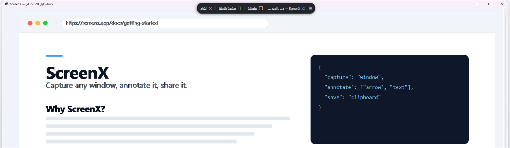
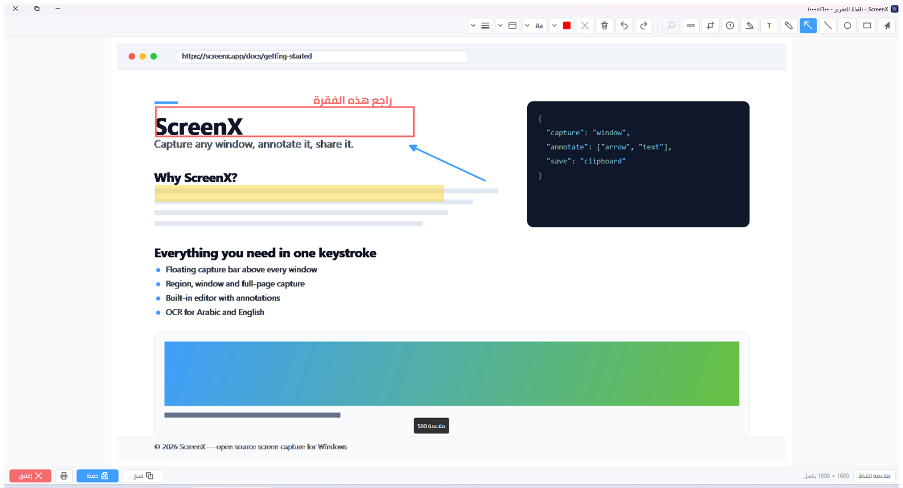
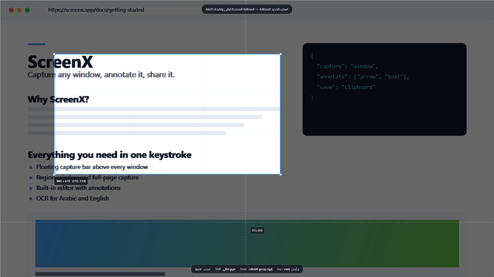
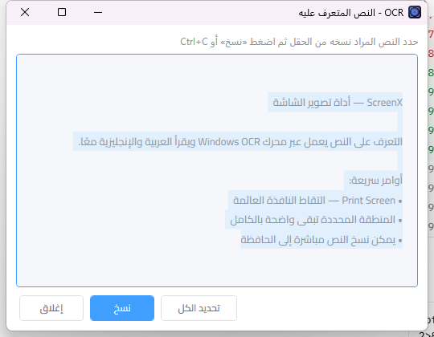

بسم الله الرحمن الرحيم

# ScreenX

**أداة عربية لالتقاط الشاشة وتحرير الصور على Windows.**

تجمع ScreenX بين التقاط النوافذ والمناطق والصفحات الطويلة، ومحرر صور مدمج، والتعرّف على النصوص العربية والإنجليزية — بواجهة عربية تدعم اتجاه **RTL**.

[الميزات](#الميزات) · [لقطات من التطبيق](#لقطات-من-التطبيق) · [التقنيات](#التقنيات) · [اختصار الالتقاط](#اختصار-الالتقاط)

## الميزات

- **التقاط مرن:** نافذة محددة، منطقة أو عدة مناطق، وصفحة كاملة مع تمرير ودمج تلقائي.
- **محرر صور مدمج:** أسهم وأشكال ونص وقلم وهايلايت وترقيم وقص، مع تراجع وإعادة.
- **إطارات للصور:** 12 نمطًا، مع خيارات للألوان والسماكة والحشوة.
- **OCR عربي وإنجليزي:** استخراج النص أو تمييز الكلمات داخل الصورة.
- **إدارة اللقطات:** معرض للمناطق المجمّعة، وآخر 50 لقطة مع خيارات التعديل والنسخ والحذف.
- **تكامل مع Windows:** اختصار عام قابل للتخصيص، شريط ساعة، تشغيل عند بدء النظام ومجلد لقطات قابل للتغيير.

## لقطات من التطبيق

| الالتقاط | المحرر |
|:---:|:---:|
|  |  |

| تحديد منطقة | نتيجة OCR |
|:---:|:---:|
|  |  |

## اختصار الالتقاط

يبدأ الالتقاط افتراضيًا بزر **Print Screen**، ويمكن تغيير الاختصار إلى تركيبة أخرى من إعدادات التطبيق.

## التقنيات

- **WPF و.NET 8** بواجهة عربية من اليمين إلى اليسار وخط Cairo.
- **Windows.Media.Ocr** للتعرف على النص العربي والإنجليزي.
- **Win32 وUI Automation** للتقاط النوافذ والتكامل مع النظام.

